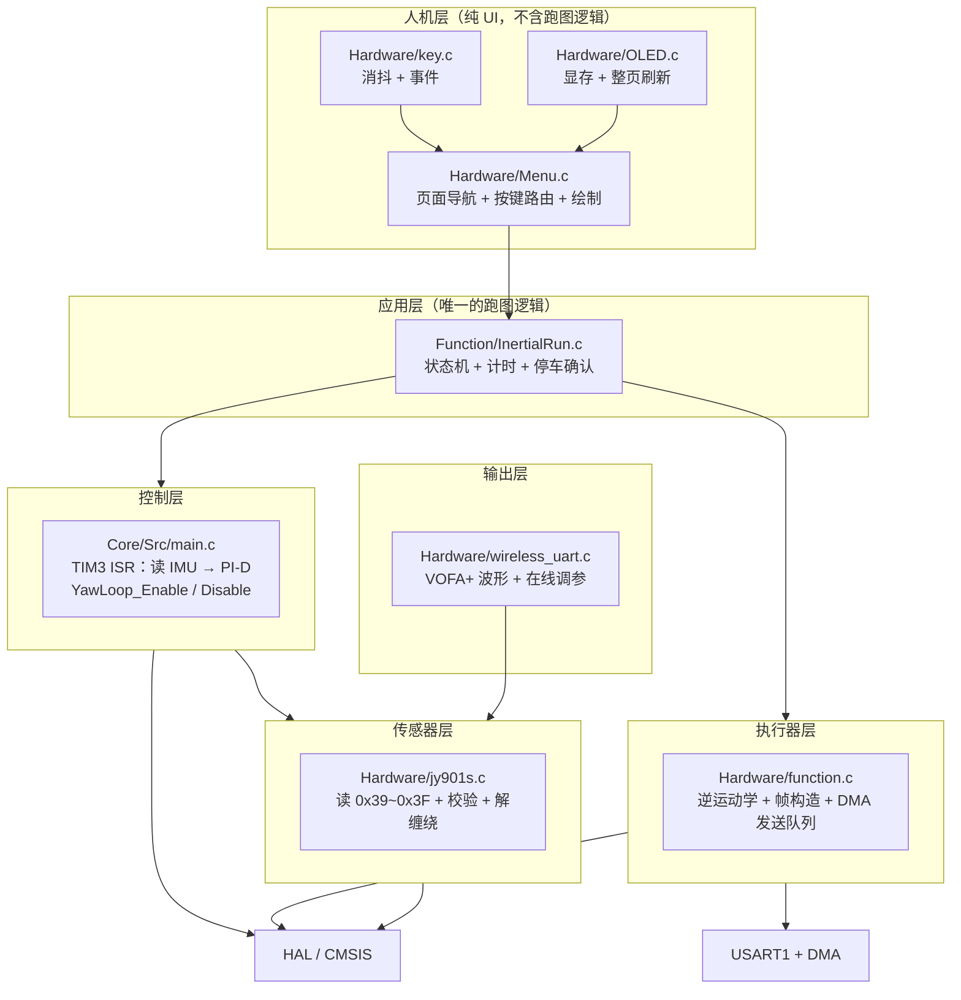
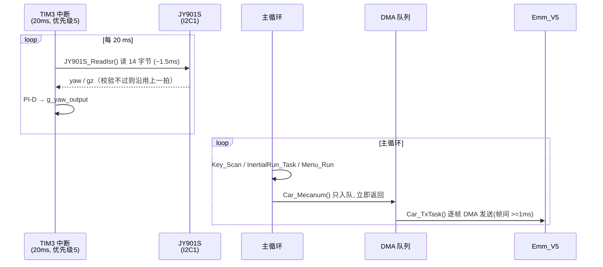
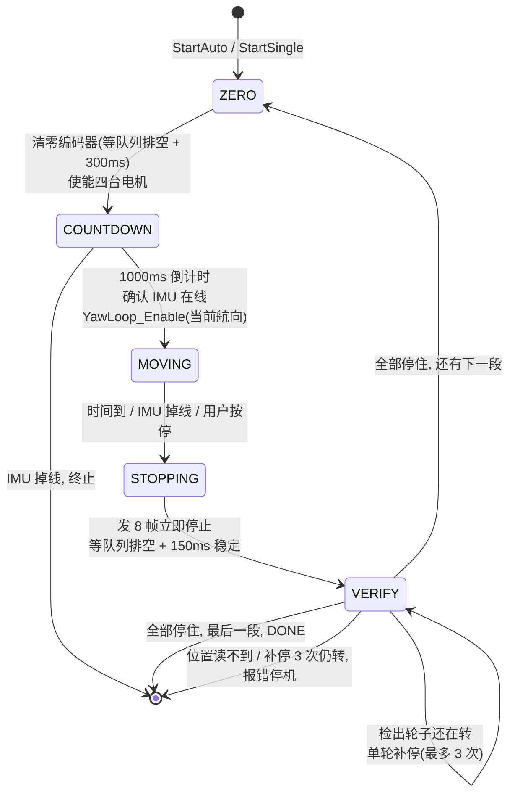

# 四麦轮惯导循迹底盘控制系统

> STM32F407 + 四个张大头（Emm_V5）闭环步进电机 + JY901S 陀螺仪的麦克纳姆轮惯导跑图工程。
> 每一段运动都做**航向姿态闭环**：定时器中断里读陀螺仪、算 PI-D，主循环通过 DMA 队列下发串口指令。

<p>


</p>

---

## 目录

- [1. 项目简介](#1-项目简介)
- [2. 功能特性](#2-功能特性)
- [3. 硬件平台](#3-硬件平台)
- [4. 软件架构](#4-软件架构)
- [5. 运行逻辑](#5-运行逻辑)
- [6. 核心设计要点](#6-核心设计要点)
- [7. 关键参数速查](#7-关键参数速查)
- [8. 编译与烧录](#8-编译与烧录)
- [9. 上电与操作](#9-上电与操作)
- [10. 调试流程](#10-调试流程)
- [11. 通信协议](#11-通信协议)
- [12. 已知限制与路线图](#12-已知限制与路线图)
- [13. 仓库结构](#13-仓库结构)

---

## 1. 项目简介

这是一套**反恐排爆救援机器人**的底盘运动控制系统。整条控制链完全跑在 STM32F407 上，上位机不参与实时控制：

- 底盘是**四轮麦克纳姆轮**，每个轮子由一台**张大头 Emm_V5 闭环步进驱动器**驱动（四台挂在同一条串口总线上，按地址 1~4 寻址）。
- 姿态反馈来自 **维特智能 JY901S** 九轴模块，通过 **I2C1** 读取解算后的航向角与 Z 轴角速度。
- 「惯导跑图」指：预先实测出一条由若干段（直行 / 左移）组成的路径，每段给定运行时长，车按序跑完，**每一段运行期间都用陀螺仪做航向闭环**，让车沿直线而不是斜着飘出去。

工程上真正的难点不是控制算法，而是**实时性纪律**：一条串口总线要承载四个电机的命令流，中间还夹着一个 20 ms 周期、会做 1.5 ms 阻塞 I2C 读取的定时器中断；而这套总线对**丢帧极其敏感** —— 丢掉一帧停止命令，就会有一个轮子继续转下去。

本项目把这三件事分开解决：

| 问题 | 解法 |
|---|---|
| 并发访问串口 | 所有命令进**一个 DMA 环形队列**，全工程只有一个发送者 |
| I2C 与中断打架 | I2C **只在定时器中断里**读，全工程只有一个访问点 |
| 丢帧导致停不下来 | 停车只发**立即停止帧**（不依赖广播同步）+ 编码器**实测确认** + 单轮补停 |

整套代码**没有使用任何互斥量**。

---

## 2. 功能特性

| 功能 | 说明 |
|---|---|
| **航向姿态闭环** | TIM3 中断 20 ms 一拍，中断内完成「读 IMU → PI-D → 写输出」 |
| **麦轮全向运动** | 逆运动学支持前进 / 后退 / 左移 / 右移 / 自转任意叠加，可「边横移边纠航向」 |
| **两种运行模式** | 自动跑图（预设 5 段）+ 单段调试（方向/时长现场可调），共用同一套状态机 |
| **确认式停车** | 停车不是「发一帧就完事」，而是「发命令 → 编码器确认真的停住 → 单轮补停，最多 3 次」 |
| **统一 DMA 发送队列** | 主循环永不阻塞，不会出现 `HAL_BUSY` 丢帧，帧间有确定间隔 |
| **陀螺仪坏帧过滤** | 全 0x00 / 全 0xFF / 角速度越界 / 航向单拍跳变 > 30° 四种判据，坏帧丢弃但闭环不停摆 |
| **IMU 掉线保护** | 200 ms 无有效数据立即停车并终止任务，不会带着错误航向继续跑 |
| **在线调参** | 无线串口（VOFA+）实时上报航向/误差/Kp/Kd，支持在线改 Kp / Ki / Kd |
| **极简 OLED 界面** | 3 个页面：选择页 / 自动跑图 / 单段调试，全英文，一行一信息 |

---

## 3. 硬件平台

### 3.1 主控

| 项目 | 参数 |
|---|---|
| MCU | STM32F407ZGTx（Cortex-M4F） |
| 主频 | 168 MHz（HSE 8 MHz，PLL M=4 N=168 P=2 Q=4） |
| Flash / RAM | 1 MB / 128 KB SRAM + 64 KB CCM |
| 总线频率 | AHB 168 MHz，APB1 42 MHz（定时器时钟 84 MHz） |
| 开发环境 | Keil MDK-ARM，ARMCLANG V6.22，C99，`-O3` |

### 3.2 外设分配

| 外设 | 引脚 | 参数 | 用途 | 访问方式 |
|---|---|---|---|---|
| I2C1 | PB6 / PB7 | 100 kHz | JY901S 陀螺仪（0x50） | **仅在 TIM3 中断内阻塞读** |
| TIM3 | — | 84 MHz / 8400 / 200 = **50 Hz（20 ms）** | 姿态环节拍 | 更新中断，NVIC 优先级 5 |
| USART1 | PA9 / PA10 | 115200 8N1 | 四台 Emm_V5 步进驱动器总线 | TX **DMA 队列**；RX 轮询 |
| USART2 | PA2 / PA3 | 9600 8N1 | 无线串口 / VOFA+ 上位机 | TX DMA；RX 逐字节中断 |
| 软件 I2C | PD10 (SCL) / PD8 (SDA) | 位翻转 ≈100 kHz | SSD1306 OLED 128×64 | 主循环轮询 |
| GPIO | PE0 / PE1 / PE2 | 上拉输入 | 3 个按键 | 10 ms 采样，3 次消抖 = 30 ms |
| DMA | USART1_TX: DMA2_S7<br>USART2_TX: DMA1_S6<br>USART2_RX: DMA1_S5 | CH4 | — | — |

> USART3 已随起重轴模块一并停用（初始化函数仍保留在 `usart.c` 里，需要时再调用）。

### 3.3 轮系与电机映射

```
                 车头
        ┌────────┬────────┐
        │  3 号  │  1 号  │      1 = 右前    2 = 右后
        │  左前  │  右前  │      3 = 左前    4 = 左后
        ├────────┼────────┤
        │  4 号  │  2 号  │      左侧两轮物理安装方向相反，
        │  左后  │  右后  │      由 MOTOR_3/4_DIR_INVERT 单轮翻转
        └────────┴────────┘
```

### 3.4 中断优先级

| 中断 | 抢占优先级 | 理由 |
|---|---|---|
| USART1 / USART2 | 0 | 串口收发不能被 I2C 读取拖延 |
| **SysTick** | **0** | 中断里 1.5~4.5 ms 的 I2C 读取会连续吞掉 1~4 个 tick，`HAL_GetTick()` 变慢会让「3.3 秒的一段」实际跑 3.6 秒 |
| TIM3 | 5 | 20 ms 控制节拍，允许被上述两类抢占 |

---

## 4. 软件架构

### 4.1 分层



**职责边界（这套代码的核心纪律）**

| 层 | 只做什么 | 绝对不做什么 |
|---|---|---|
| `InertialRun` | 决定「现在该不该动、往哪动、什么时候停」 | 不碰 I2C、不拼串口帧、不画屏 |
| `Menu` | 把按键翻译成「开始/停止/调参/换页」，把快照画到屏上 | **不含任何跑图状态机** |
| `main.c` | 中断里算航向；主循环按固定顺序调度 | 不发电机命令 |
| `function.c` | 逆运动学、帧构造、发送队列 | 不知道「航向」是什么 |
| `jy901s.c` | 读一帧、校验、解缠绕 | 不碰串口、不调用 `HAL_Delay` |

### 4.2 主循环调度顺序

```c
while (1)
{
    Key_Scan();            // 1. 按键扫描(内部 10ms 限频)
    InertialRun_Task();    // 2. 跑图状态机: 计时 / 下发 / 停车 / 编码器确认
    Car_TxTask();          // 3. 推进底盘发送队列(放在刷屏之前)
    Menu_Run();            // 4. 按键路由 + 绘制(可能占用十几毫秒)
    Wireless_ReportYaw();  // 5. VOFA+ 上报(内部 40ms 限频)
}
```

`Car_TxTask()` 刻意排在 `Menu_Run()` 之前 —— 刷一次 OLED 要十几毫秒，放在后面会让电机命令多等一帧。

### 4.3 双执行上下文



### 4.4 共享状态与所有权

| 变量 | 写者 | 读者 | 保护方式 |
|---|---|---|---|
| `jy901s_data` | TIM3 ISR | 主循环各处 | 32 位对齐读写原子，`ready` 为 volatile |
| `g_yaw_output` | TIM3 ISR | InertialRun | 32 位 float 单次写原子 |
| `g_yaw_loop_enable` / `g_yaw_target` / `g_yaw_out_max` | `YawLoop_*`（关中断） | TIM3 ISR | 关中断下整组更新 |
| `g_yaw_kp` / `g_yaw_ki` / `g_yaw_kd` | USART2 ISR | TIM3 ISR | 32 位 float 单次写原子 |
| 发送队列头尾指针 | 主循环 | 主循环 | 单上下文 |
| `s_tx_inflight` / `s_tx_finished` | USART1 ISR / 主循环 | 主循环 | 单字节 volatile 标志 |

---

## 5. 运行逻辑

### 5.1 上电流程

```
HAL_Init()
  └─ HAL_NVIC_SetPriority(SysTick_IRQn, 0, 0)     ← 先校准时基
SystemClock_Config()                               ← 168 MHz
MX_GPIO_Init() → OLED_Init() → "BOOTING..."
MX_DMA_Init / MX_I2C1 / MX_USART1 / MX_USART2 / MX_TIM3_Init
JY901S_Init()
HAL_Delay(500) → JY901S_ReadIsr()                  ← 探活读一次
JY901S_SetOutputRate(100Hz)                        ← 写进模块，断电不丢
JY901S_ZeroYaw()                                   ← 建立 0° 基准
Key_Init() / InertialRun_Init() / Menu_Init()
Wireless_Init()
FPU->FPCCR |= ASPEN | LSPEN
HAL_TIM_Base_Start_IT(&htim3)                      ← 闭环总开关
YawLoop_Disable()                                  ← 上电默认不闭环
       ↓
    while(1) { ... }
```

两条**硬顺序约束**：

1. `HAL_TIM_Base_Start_IT(&htim3)` **必须**在所有 I2C 初始化之后 —— 一旦启动，IMU 就只归中断读。
2. `JY901S_SetOutputRate()` / `JY901S_ZeroYaw()` **必须**在启动之前 —— 它们内部是阻塞 I2C 写。

### 5.2 控制层：中断里做什么

`Core/Src/main.c` 的 `HAL_TIM_PeriodElapsedCallback()` 每 20 ms 执行：

```
1. JY901S_ReadIsr()        读 14 字节 @100kHz ≈ 1.5ms（最坏 3ms 超时）
                            读失败 → 沿用上一拍输出，不积分
2. !g_yaw_loop_enable → 输出清零返回
3. err = g_yaw_target - jy901s_data.yaw_continuous
4. 积分器: 死区 0.2° 内不累加, |err| > 8° 时清零, 输出限幅 ±8 RPM
5. u = Kp*err + ∫ - Kd*gz
6. 对称限幅 ±g_yaw_out_max（默认 30 RPM）→ g_yaw_output
```

控制律为 **PI-D**：微分项直接用陀螺仪 Z 轴角速度，不自己差分航向角，避免噪声放大；积分项用来消掉麦克纳姆轮四轮摩擦/辊子接触不对称造成的**稳态偏航**（纯 PD 只能靠「留一点航向误差」来对抗它，表现就是横移时车头慢慢歪过去且回不来）。

CPU 占用约 **8~22%**。中断内**绝不发送串口、绝不调用 `HAL_Delay`**。

### 5.3 数据流：从陀螺仪到轮子

```
        JY901S (0x39 GZ / 0x3F Yaw)
             │ I2C1 @100kHz, 14 bytes
             ▼
   ┌─────────────────── TIM3 ISR ───────────────────┐
   │ 校验: 全0 / 全FF / |GZ|>1200dps / |Δyaw|>30°/拍 │
   │ 解缠绕 → yaw_continuous                        │
   │ PI-D  →  g_yaw_output  (RPM, ±30)              │
   └───────────────────────┬────────────────────────┘
                           │ 32-bit float 写入原子
                           ▼
   ┌──────────────── 主循环 ─────────────────────────┐
   │ InertialRun: 段类型 → (vx, vy), omega = round(g_yaw_output)
   │        ↓                                        │
   │ Car_Mecanum(vx, vy, omega)   麦轮逆运动学       │
   │        ↓  4 帧速度 + 1 帧广播同步                │
   │ 发送队列(DMA, 帧间 >=1ms) ──────────────────► USART1
   └─────────────────────────────────────────────────┘
```

**麦轮逆运动学**（`Car_Mecanum`）：

```c
右前 = vx + vy + omega
右后 = vx - vy + omega
左前 = vx - vy - omega
左后 = vx + vy - omega
```

- `omega > 0` → 右轮前进、左轮后退 → 俯视**逆时针（左转）**，与 JY901S「左转 yaw 增大」同号
- `vy > 0` → 右前/左后前进、右后/左前后退 → 整车**左移**
- 三种分量可任意叠加，所以「边横移边纠航向」只是 `Car_Mecanum(0, 50, w)` 一个调用

### 5.4 惯导跑图状态机（`Function/InertialRun.c`）

两种模式共用一套状态机：

| 模式 | 段数 | 段内容 |
|---|---|---|
| `IR_MODE_AUTO` | 5 | 直行 3.3s → 左移 3.8s → 直行 4.8s → 左移 4.4s → 直行 4.9s |
| `IR_MODE_SINGLE` | 1 | 方向 + 时长由界面设定（0.5~10.0 s） |



**`VERIFY` 是这套系统的关键一步**：

1. 停稳 150 ms 后读一次四轮 `S_CPOS` 记为基准 A；
2. 再等 150 ms 读第二次，与 A 逐轮比较；
3. 任一电机差值 > **40 脉冲**（≈ 1.6 RPM 以上）判定它还在转，**单独给这一台补两帧「立即停止」**，重试最多 3 次；
4. 三次仍转 → 报 `WHEEL STUCK` 并整体停机；位置读不到 → 报 `POS ERR`。

### 5.5 一次完整跑图的时间线

```
t=0         InertialRun_StartAuto() → ZERO
t≈4ms       四轮 S_CPOS 清零帧入队，等待队列排空 + 300ms
t≈310ms     四台使能帧入队 → COUNTDOWN
t=1310ms    YawLoop_Enable(当前航向)  ← 每段独立记目标
            Car_Mecanum(50, 0, 0) 入队，起跑
t=1310..4610ms   每 20ms 重发一次 Car_Mecanum(50, 0, w)
                 w 来自中断，±30 RPM 内实时纠偏
t=4610ms    时间到 → YawLoop_Disable() → STOPPING
t≈4620ms    8 帧立即停止入队并排空(帧间 1ms，约 12ms)
t≈4770ms    VERIFY: 读四轮位置 A
t≈4920ms    读位置 B，比较 → 都在 ±40 脉冲内
t≈4930ms    ZERO(清零) → 300ms → 下一段 COUNTDOWN
...
最后一段结束 → 不清零位置，屏幕保留该段 S_CPOS，状态 DONE
```

整趟 5 段约 **29 秒**。

### 5.6 各动作的耗时预算

| 动作 | 耗时 | 说明 |
|---|---|---|
| `JY901S_ReadIsr()` | ≈1.5 ms（最坏 3 ms） | 中断内，占 20 ms 的 8~15% |
| `Car_Mecanum()` | **≈0**（只入队） | 队列按 1 ms 间隔自己排空 |
| `Car_Stop()` | ≈0（入队 8 帧） | 实际发送约 12 ms，由 `Car_TxTask` 在后台完成 |
| `Car_ReadPositionCount()` | ≤40 ms | 唯一的阻塞操作，只在停车确认时用 |
| `OLED_Refresh()` | ≈9 ms | 一页一次 Start + 连续写 128 字节 |
| `InertialRun_Task()` 状态判断 | ≈0 | 纯比较 |

---

## 6. 核心设计要点

这一节记录「为什么代码长这样」，也是踩过的坑。改动前建议先读。

### 6.1 为什么发送要统一进 DMA 队列

最初的做法是：速度帧走 `HAL_UART_Transmit_DMA`（厂商例程），停止帧走阻塞式 `HAL_UART_Transmit`。

问题在于 HAL 的这两个接口**共用** `huart1.gState`，都要求 `gState == HAL_UART_STATE_READY`，否则直接返回 `HAL_BUSY`，**一个字节都不发**。只要发停止帧的那一刻上一次 DMA 还没结束，那一帧停止命令就被静默丢掉 —— 而原来的 `Car_Stop()` 只发一次、没有重发机制。

另外阻塞发送还有个隐蔽问题：`HAL_UART_Transmit` 是逐字节轮询 TXE 的，中途被 TIM3 打断（中断里读 I2C 要 1.5 ms）就会在同一帧内制造超过 1 ms 的空隙，驱动器会按帧尾错误把整帧丢掉。

现在所有帧都进同一个环形队列，`Car_TxTask()` 逐帧 DMA 发出：

- 全工程只有一个发送者 → **不可能出现 `HAL_BUSY`**
- 帧间强制 ≥1 ms 间隔 → 给驱动器留出解析时间
- 主循环**永不阻塞** → 20 ms 的控制节拍不再被串口拖慢
- `Car_TxFlush()` 让需要「确认命令已发完」的地方（停车、读位置）有确定的时间点

### 6.2 为什么停车绝不能依赖广播同步帧

这是「**1 号电机偶尔停不下来**」的一个确定机制：

缓存式停止（`snF=1`）要求驱动器「**先收到自己那帧停止、再收到同步帧**」。只要任意一帧在驱动器侧丢了，那个驱动器的缓存里就还是上一拍的速度命令；随后到来的广播同步帧会把那条**旧速度重新执行** —— 那个轮子反而被「唤醒」，继续按原速度跑。

而 `Car_Stop()` 原来的发送顺序恰恰是「4 帧缓存停止 + 1 帧广播同步」，等于给每个可能丢帧的驱动器准备了一次「复活」。

**现在的做法**：停车只发 `snF=0` 的立即停止帧（收到即停，与后续帧完全无关），发两轮冗余，**一个同步帧都不发**。广播同步只保留在启动路径上 —— 那里同步是必要的（四轮必须同时起步，否则车会先歪一下）。

配合 `VERIFY` 的编码器确认和单轮补停，即使丢帧也能自愈。

### 6.3 为什么 I2C 必须放在定时器中断里

原来的方案是主循环轮询 I2C，带来三个连锁问题：

1. 主循环要刷 OLED（整屏十几毫秒），读数节奏完全不可控；
2. 主循环读到一半可能被中断打断，读到「改了一半」的数据；
3. 一旦读失败几次，驱动的重试间隔被拉长 —— 而重试间隔比「IMU 掉线判据」还长，直接导致误判停车。

搬进 20 ms 的 TIM3 中断后：采样时刻严格固定（PID 的 dt 是常数）、只有这一个上下文碰 I2C（不需要任何锁）、读完立刻算 PID（数据新鲜度最高）。

配套的必要修改：**I2C 路径里所有 `HAL_Delay` 必须删掉**。TIM3 优先级 5 高于 SysTick 的默认优先级 15，中断里等 tick 就是等一个永远不会到来的事件。

### 6.4 为什么 SysTick 要提到最高优先级

TIM3（5）会抢占 SysTick（15）。中断里读一次 I2C 1.5 ms，最坏 4.5 ms，而 SysTick 周期只有 1 ms —— 一次读就能吃掉 1~4 个 tick。SysTick 是**单一位挂起标志**，被屏蔽期间到期的多个周期只会补一次，`HAL_GetTick()` 就越跑越慢。

所有分段时长、超时判据都基于 `HAL_GetTick()`，时基慢 10% 意味着「3.3 秒的一段」实际跑 3.6 秒。把 SysTick 提到和 USART 一样的最高优先级后，它能随时抢占 TIM3，时基恢复准确。

### 6.5 为什么坏帧要丢弃而不是修正

单次 14 字节的 I2C 读有可能跨在模块刷新寄存器的瞬间，拿到「半旧半新」的帧 —— 这种帧的 Yaw 可能突然跳几十度，直接喂给 PID 会导致猛打方向。

驱动里用四条判据拦截：整帧全 `0x00` / 全 `0xFF`、`|GZ| > 1200 °/s`、航向单拍跳变 > 30°。命中任一条就**丢弃这一拍**，`jy901s_data` 保持上一拍的合法值，闭环照常跑 —— 绝不停摆、也绝不把假数据送进 PID。

### 6.6 七道保护

| # | 机制 | 拦什么 |
|---|---|---|
| 1 | I2C 只在中断里读 | 读到半新半旧、被抢占 |
| 2 | SysTick 优先级 0 | 时基变慢 → 分段距离错 |
| 3 | 坏帧判据 | 假角度进 PID |
| 4 | DMA 发送队列 + 帧间隔 | `HAL_BUSY` 丢帧、帧内被插空 |
| 5 | 停车只发立即停止 + 两轮冗余 | 同步帧把旧速度「复活」 |
| 6 | `VERIFY` 编码器确认 + 单轮补停 | 驱动器侧漏帧 |
| 7 | IMU 掉线（200 ms）→ 停车并终止任务 | I2C 掉线后盲目继续 |

---

## 7. 关键参数速查

### 7.1 航向环（`Core/Src/main.c`）

| 宏 | 默认值 | 含义 |
|---|---|---|
| `YAW_KP_DEFAULT` | 4.0 | 比例：误差 1° 给多少 RPM |
| `YAW_KI_DEFAULT` | 0.30 | 积分：RPM/(°·s) |
| `YAW_KD_DEFAULT` | 0.35 | 微分：阻尼，作用于 gz |
| `YAW_DT_S` | 0.02 | 控制周期（s），**必须与 TIM3 一致** |
| `YAW_DEADBAND_DEG` | 0.20 | 死区（°），小于它不再积分 |
| `YAW_INT_MAX_RPM` | 8.0 | 积分项输出限幅 |
| `YAW_INT_RESET_DEG` | 8.0 | 超过该误差清积分 |
| `YAW_OUT_MAX_DEFAULT` | 30.0 | 总输出限幅（RPM） |
| `YAW_IMU_TIMEOUT_MS` | 200 | IMU 掉线判据（ms） |

### 7.2 跑图（`Function/InertialRun.c`）

| 宏 | 默认值 | 含义 |
|---|---|---|
| `IR_SPEED_RPM` | 50 | 平移速度，**改它必须重采时长表** |
| `IR_TURN_MAX` | 30.0 | 航向修正限幅（RPM） |
| `IR_STEER_MS` | 20 | 底盘命令刷新周期（ms） |
| `IR_LEAD_MS` | 1000 | 起跑倒计时（ms） |
| `IR_STOP_SETTLE_MS` | 150 | 停车后等多久读第一次位置 |
| `IR_VERIFY_GAP_MS` | 150 | 两次位置读取的间隔 |
| `IR_MOVE_THRESHOLD` | 40 | 「还在转」的脉冲差值门限 |
| `IR_VERIFY_MAX_RETRY` | 3 | 补停最多重试次数 |
| `IR_ZERO_WAIT_MS` | 300 | 位置清零后的等待 |
| `IR_SINGLE_MS_MIN` / `MAX` | 500 / 10000 | 单段调试时长范围 |

### 7.3 发送队列（`Hardware/function.c`）

| 宏 | 默认值 | 含义 |
|---|---|---|
| `CAR_TX_QUEUE_LEN` | 16 | 队列深度（可用 15 帧） |
| `CAR_FRAME_GAP_MS` | 1 | 帧间最小间隔 |
| `CAR_ACC` | 5 | 加减速档位 0~255 |
| `CAR_MAX_RPM` | 5000 | 驱动器转速上限 |
| `CAR_POS_TOTAL_MS` | 40 | 读位置的单次总超时预算 |

### 7.4 传感器（`Hardware/jy901s.h`）

| 宏 | 默认值 | 含义 |
|---|---|---|
| `JY901S_I2C_ADDR` | 0x50 | 7 位地址 |
| `JY901S_I2C_TIMEOUT` | 3 | 单次传输超时（ms），**等于中断最多被卡多久** |
| `JY901S_REG_FAST_START` | 0x39 | 精简读取起始寄存器（GZ） |
| `JY901S_REG_FAST_NUM` | 7 | 7 个寄存器 = 14 字节（0x39~0x3F） |
| `JY901S_MAX_YAW_STEP` | 30.0 | 单拍航向跳变门限（°） |
| `JY901S_MAX_GZ_ABS` | 1200.0 | 角速度合理上限（°/s） |
| `JY901S_YAW_SIGN` | 1.0 | 模块装反时改成 -1.0，其余代码不用动 |

### 7.5 编译开关（`Core/Src/main.c`）

| 宏 | 默认值 | 说明 |
|---|---|---|
| `WIRELESS_ENABLE` | 1 | 置 0 关闭无线串口上报与在线调参，不影响跑图 |

---

## 8. 编译与烧录

### 8.1 环境

- **Keil MDK-ARM 5.x**，需安装 **ARMCLANG V6.22** 或更高（工程用 AC6，`uC99=1`）
- **STM32F4xx_DFP** 器件包（`STM32F407ZGTx`）
- DAP-Link / ST-Link 驱动

### 8.2 编译

用 Keil 打开 `MDK-ARM/fish.uvprojx`，直接 **Build (F7)**。或命令行：

```bat
UV4.exe -b MDK-ARM\fish.uvprojx -o build.log
```

产物：`MDK-ARM/fish/fish.hex`。

### 8.3 烧录

```bat
STM32_Programmer_CLI.exe -c port=SWD -w MDK-ARM\fish\fish.hex -v -rst
```

### 8.4 修改外设配置

外设由 STM32CubeMX 维护，配置文件为 `fish.ioc`。手写代码全部放在 `USER CODE BEGIN/END` 保护段内或独立文件里，重新生成不会覆盖。

---

## 9. 上电与操作

上电后直接进入**选择页**，不会自动跑车。

```
=== FISH RUNNER ===        ← 选择页
>Auto Run
 Single Seg
Yaw:  -0.3
IMU 99% F:0 B:0
PE1:Next  PE0:OK
```

| 页面 | 按键 | 动作 |
|---|---|---|
| **MAIN** | PE1 | 光标在 Auto Run / Single Seg 之间切换 |
| | PE0 | 进入所选页面 |
| **AUTO** | PE0 | 开始 / 停止（同一键切换） |
| | PE2 长按 | 返回选择页（仅在空闲时） |
| **SINGLE** | PE0 | 开始 / 停止 |
| | PE1 | 切换方向 FWD → LEFT → RIGHT → BACK（空闲时） |
| | PE2 短按 | 时长 +0.5 s（500~10000 ms 循环，空闲时） |
| | PE2 长按 | 返回选择页（空闲时） |

跑起来后的界面：

```
AUTO 2/5 LEFT              SINGLE FWD 2.0s
T:2.6s E:-0.3              T:1.2s E:+0.1
M1  -190748                M1   18452
M2   190824                M2  -18431
M3  -190716                M3   18440
M4   190860                M4  -18460
RUN                        RUN
PE0:STOP                   PE0:STOP
```

第 2 行的 `E:` 是实时航向误差，**调 Kp/Ki 就看这一行**。跑完一段后 `M1~M4` 显示该段四轮的 `S_CPOS` 脉冲数，可直接和 `InertialRun.c` 顶部的标定表对比。

---

## 10. 调试流程

按顺序推进，每一步只引入一个新变量：

### 步骤 1 · 上电看 IMU 质量

选择页第 6 行 `IMU 99% F:0 B:0`：

- `99%` = 有效帧占比，**要求 ≥ 95%**；
- `F` = I2C 通信失败次数；
- `B` = 通信成功但被判为坏帧的次数。

`F` 高 → 先查接线，再**补 4.7 kΩ 上拉到 3.3 V**（模块只靠 STM32 内部约 40 kΩ 弱上拉撑 100 kHz，边沿太慢是丢帧主因）。
`B` 高 → 多半是模块回传率与读取节奏的相位问题，可试 `JY901S_RRATE_50HZ`。

### 步骤 2 · 架空看闭环输出

进 **Single Seg**，方向 FWD，时长 1.0 s，按 PE0 启动。手扶车体观察 `E:`：

- 车头偏左 → `E:` 为正 → 车应向右回转；
- `E:` 能被压在 ±1° 内说明环在工作。

### 步骤 3 · 落地单段 FWD 2 s × 20 次

看两件事：**走直度** 和 **停车可靠**（有没有轮子不停）。

出现 `WHEEL RETRY` 说明丢帧被检出并补停了，属于正常自愈；出现 `WHEEL STUCK` 才说明驱动器或接线真有问题。

### 步骤 4 · 单段 LEFT 2 s

横移的偏航耦合比直行大，主要在这一步调 `Ki`。整定顺序：先 Kp（加到「修得够快但开始有点晃」）→ 加 Kd 压晃动 → 最后一点点加 Ki 消残余稳态偏航。

### 步骤 5 · 全套 5 段 AUTO

每段结束屏幕显示该段四轮 `S_CPOS`，与 `InertialRun.c` 顶部标定表对比，偏差应 < 5%。若某段系统性偏离，优先怀疑该段时长需重采，而不是控制参数。

---

## 11. 通信协议

### 11.1 Emm_V5 步进驱动器（USART1，115200）

`Hardware/function.c` 是唯一的帧构造与发送点：

| 功能 | 帧格式 | 说明 |
|---|---|---|
| 使能 | `addr F3 AB en 00 6B` | `addr` = 01~04 |
| 速度 | `addr F6 dir velH velL acc snF 6B` | `snF=1` 缓存等同步；`acc=5` |
| 立即停止 | `addr FE 98 00 6B` | `snF=0` 收到即停，**停车只用这个** |
| 广播同步 | `00 FF 66 6B` | 地址 0x00 = 广播，**只在启动路径使用** |
| 读位置 | `addr 36 6B` | 应答 `addr 36 sign v3 v2 v1 v0 6B` |
| 位置清零 | `addr 0A 6D 6B` | — |

> `dir`：0 = CW，1 = CCW。「前进」对应哪个方向由 `MOTOR_x_DIR_INVERT` 决定。
> 每帧最后一字节 `0x6B` 是校验字节，不是累加和。

### 11.2 VOFA+ 上报（USART2，9600）

上行 FireWater 帧（40 ms 一帧）：

```
目标航向, 当前航向, Kp, Kd\n
例:  12.34,-5.60,4.00,0.35\n
```

下行调参（ASCII 文本行，`\n` 结尾）：

| 写法 | 作用 |
|---|---|
| `6.0,0.4` | 同时设 Kp、Kd |
| `6.0,0.3,0.4` | 同时设 Kp、Ki、Kd |
| `P6.0` | 只设 Kp |
| `I0.3` | 只设 Ki |
| `D0.4` | 只设 Kd |

### 11.3 JY901S 寄存器（I2C1，0x50）

精简读取区间 `0x39 ~ 0x3F`（7 个寄存器，14 字节，小端）：

| 寄存器 | 内容 | 缓冲区偏移 |
|---|---|---|
| 0x39 | GZ 角速度 | `buf[0..1]` |
| 0x3A~0x3C | 磁场（不使用） | — |
| 0x3D | Roll | `buf[8..9]` |
| 0x3E | Pitch | `buf[10..11]` |
| 0x3F | Yaw | `buf[12..13]` |

满量程：角度 ±180° → ±32768，角速度 ±2000 °/s → ±32768。
配置需先写 `KEY(0x69) = 0xB588` 解锁，再写 `RRATE(0x03)`。

---

## 12. 已知限制与路线图

### 当前限制

| 项 | 说明 |
|---|---|
| 分段按时间，不按编码器到位 | 电池电压、地面打滑会改变同样的时间对应的距离；短距离误差更明显 |
| 6 轴解算的 Yaw 会缓慢漂移 | 无磁力计，长时间跑图需要中途重零或重新校准陀螺 |
| I2C 仅内部弱上拉 | 建议硬件补 4.7 kΩ；这是通信失败的主要来源 |
| 无独立看门狗 | IWDG 未使能，无人值守场景建议加上 |
| 无线串口 9600 / 40 ms | 一帧约 30 字节 ≈ 31 ms，占空比已接近上限；想更密需提波特率 |
| 只有 3 个按键 + 128×64 单色屏 | 交互能力有限，界面文字只能用英文 |

### 路线图

- [ ] 分段终止条件改为**编码器脉冲到位**（只需替换 `IR_MOVING` 的出口判断）
- [ ] 加入里程计 + 航向的**二维位姿闭环**，替代纯时间分段
- [ ] 陀螺仪改用 **UART 数据流 + DMA/空闲中断**，彻底消除 I2C 撕裂读取与总线争用
- [ ] 接入 IWDG，异常自动复位
- [ ] 停车确认失败时通过无线串口主动上报故障码

---

## 13. 仓库结构

```
fish/
├── Core/                          ← STM32CubeMX 生成 + 应用入口
│   ├── Inc/
│   │   ├── main.h                 ★ 航向环对外接口(USER CODE EFP)
│   │   ├── i2c.h / usart.h / tim.h / dma.h / gpio.h
│   │   └── stm32f4xx_hal_conf.h / stm32f4xx_it.h
│   ├── Src/
│   │   ├── main.c                 ★ 启动流程 + TIM3 ISR + PI-D + YawLoop API
│   │   ├── stm32f4xx_it.c         中断向量
│   │   ├── i2c.c / usart.c / tim.c / dma.c / gpio.c
│   │   ├── syscalls.c / sysmem.c / system_stm32f4xx.c
│   │   └── stm32f4xx_hal_msp.c
│   └── Startup/startup_stm32f407zgtx.s
│
├── Function/                      ← 应用层
│   ├── InertialRun.c              ★ 唯一的跑图状态机(自动 5 段 + 单段调试)
│   └── InertialRun.h
│
├── Hardware/                      ← 驱动层
│   ├── function.c / .h            ★ 逆运动学 + 帧构造 + DMA 发送队列
│   ├── jy901s.c / .h              ★ JY901S 驱动(精简读取 + 校验 + 解缠绕)
│   ├── Menu.c / .h                ★ OLED 页面 + 按键路由(纯 UI)
│   ├── key.c / .h                 按键消抖 + 事件
│   ├── OLED.c / .h                SSD1306 软件 I2C 驱动
│   └── wireless_uart.c / .h       VOFA+ 上报 + 在线调参
│
├── Drivers/                       ← STM32F4 HAL + CMSIS(勿改)
├── MDK-ARM/                       ← Keil 工程
│   ├── fish.uvprojx               ★ 双击打开
│   └── fish/fish.hex              编译产物
│
├── fish.ioc                       ← STM32CubeMX 工程配置
└── README.md
```

**★ 标记的是核心文件**，按 `main.c` → `InertialRun.c` → `function.c` → `jy901s.c` 的顺序阅读即可理解全部控制逻辑。

> **已从工程移除、可以安全删除的文件**（仍留在磁盘上，但不在 `fish.uvprojx` 里）：
> `Hardware/Crane.c/.h`（起重轴，从未接入）、`Hardware/Emm_V5.c/.h`（协议已并入 `function.c`）、
> `Hardware/inertial.c/.h`（路径数据已并入 `InertialRun.c`）、`Hardware/REG.h`（寄存器定义已并入 `jy901s.h`）。
> 需要时可以从 git 历史里取回。

---

## 致谢

- [WitMotion / 维特智能](https://www.wit-motion.com/) — JY901S 九轴模块与寄存器协议
- [张大头闭环伺服](https://zhangdatou.taobao.com) — Emm_V5 闭环步进驱动器与示例代码
- STMicroelectronics — STM32F4 HAL 驱动库
- VOFA+ — 上位机波形与在线调参

---

## License

本仓库为竞赛/课程项目代码，未附加正式开源协议。如需复用其中的控制思路或代码片段，请注明出处。第三方驱动（HAL 库、Emm_V5 协议）版权归各自作者所有。
