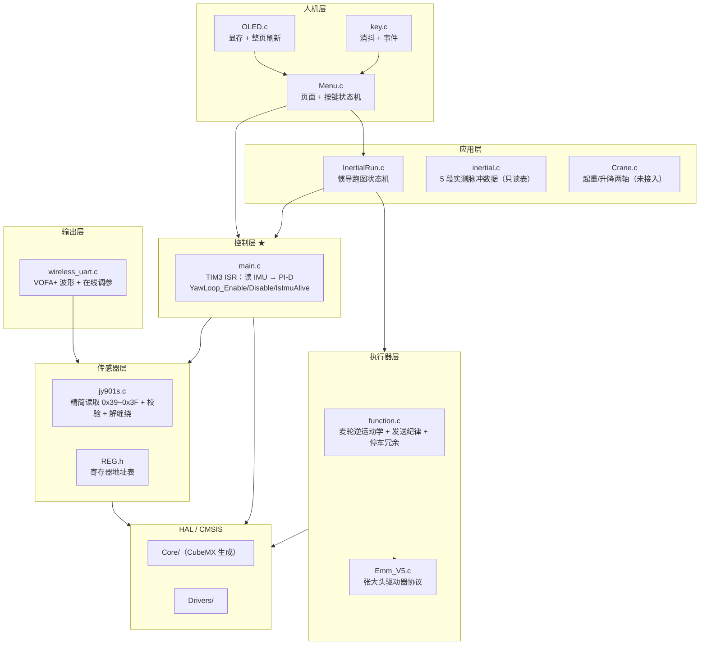
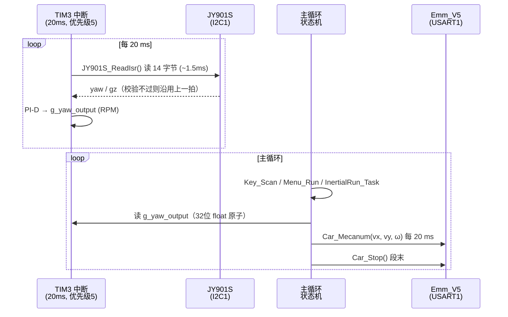
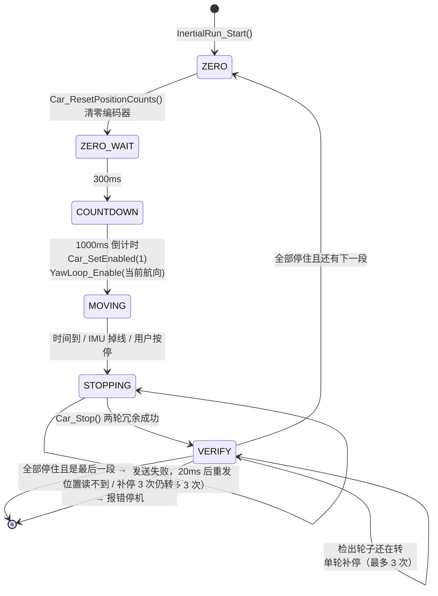

# 四麦轮惯导循迹底盘控制系统

> STM32F407 + 四个张大头（Emm_V5）闭环步进电机 + JY901S 陀螺仪的麦克纳姆轮惯导跑图工程。
> 每一段运动都做**航向姿态闭环**：定时器中断里读陀螺仪、算 PI-D、主循环下发串口指令。

<p>


</p>

---

## 目录

- [1. 项目简介](#1-项目简介)
- [2. 功能特性](#2-功能特性)
- [3. 硬件平台](#3-硬件平台)
- [4. 软件架构](#4-软件架构)
- [5. 运行逻辑](#5-运行逻辑)
- [6. 核心设计要点](#6-核心设计要点)
- [7. 关键参数速查](#7-关键参数速查)
- [8. 编译与烧录](#8-编译与烧录)
- [9. 调试流程](#9-调试流程)
- [10. 通信协议](#10-通信协议)
- [11. 已知限制与路线图](#11-已知限制与路线图)
- [12. 仓库结构](#12-仓库结构)

---

## 1. 项目简介

这是一套**反恐排爆救援机器人**的底盘运动控制系统。上位机不做实时控制，整条控制链完全跑在 STM32F407 上：

- 底盘是**四轮麦克纳姆轮**，每个轮子由一台**张大头 Emm_V5 闭环步进驱动器**驱动（四台挂在同一条串口总线上，按地址 1~4 寻址）。
- 姿态反馈来自 **维特智能 JY901S** 九轴模块，通过 **I2C1** 读取解算后的航向角与 Z 轴角速度。
- 「惯导跑图」指：预先实测出一条由若干段（直行 / 横移）组成的路径，每段给定运行时长，车按序跑完；**每一段运行期间都用陀螺仪做航向闭环**，让车沿直线而不是斜着飘出去。

工程的核心难点不在算法，而在**混速执行**：一条总线要同时跑「非阻塞 DMA 速度帧」和「阻塞式停车/读编码器帧」，中间还夹着一个 20 ms 周期、会做 1.5 ms 阻塞 I2C 读取的定时器中断。本项目把所有并发冲突都收敛到单一上下文里解决，整套代码**没有使用任何互斥量**（详见 [第 6 节](#6-核心设计要点)）。

---

## 2. 功能特性

| 功能 | 说明 |
|---|---|
| **航向姿态闭环** | TIM3 中断 20 ms 一拍，中断内完成「读 IMU → PI-D → 写输出」，主循环只负责把输出合成为轮速下发 |
| **麦轮全向运动** | 逆运动学支持前进 / 后退 / 左移 / 右移 / 自转任意叠加，因此可以「边横移边纠航向」 |
| **惯导自动跑图** | 5 段预设路径状态机，段间自动停车、验证、清零编码器、倒计时起跑 |
| **确认式停车** | 停车不再是「发一帧就完事」，而是「发命令 → 用编码器确认真的停住 → 单轮补停，最多 3 次」 |
| **陀螺仪坏帧过滤** | 全 0x00 / 全 0xFF / 角速度越界 / 航向单拍跳变 > 30° 四种判据，坏帧丢弃但闭环不停摆 |
| **IMU 掉线保护** | 150 ms 无有效数据立即停车，不会带着错误航向继续跑 |
| **在线调参** | 无线串口（VOFA+）实时上报航向/误差/Kp/Kd，支持在线改 Kp / Ki / Kd |
| **OLED 菜单** | 3 键操作，自动跑图模式 + 单段调试模式（可设方向与时长） |

---

## 3. 硬件平台

### 3.1 主控

| 项目 | 参数 |
|---|---|
| MCU | STM32F407ZGTx（Cortex-M4F，168 MHz） |
| Flash / RAM | 1 MB / 128 KB SRAM + 64 KB CCM |
| 外部晶振 | 8 MHz（`HSE_VALUE`），PLL M=4 N=168 P=2 Q=4 |
| 总线频率 | AHB 168 MHz，APB1 42 MHz（定时器时钟 84 MHz） |
| 开发环境 | Keil MDK-ARM，ARMCLANG V6.22，C99，`-O3` |

### 3.2 外设分配

| 外设 | 引脚 | 参数 | 用途 | 访问方式 |
|---|---|---|---|---|
| I2C1 | PB6 / PB7 | 100 kHz | JY901S 陀螺仪（0x50） | **仅在 TIM3 中断内阻塞读** |
| TIM3 | — | 84 MHz / 8400 / 200 = **50 Hz（20 ms）** | 姿态环节拍 | 更新中断，NVIC 优先级 5 |
| USART1 | PA9 / PA10 | 115200 8N1 | 四台 Emm_V5 步进驱动器总线 | 速度帧 DMA；停止/读编码器帧阻塞 |
| USART2 | PA2 / PA3 | 9600 8N1 | 无线串口 / VOFA+ 上位机 | TX DMA；RX 逐字节中断 |
| USART3 | PB10 / PB11 | 115200 8N1 | 起重/升降两轴（`Crane`，当前未接入） | DMA |
| 软件 I2C | PD10 (SCL) / PD8 (SDA) | 位翻转 ≈100 kHz | SSD1306 OLED 128×64 | 主循环轮询 |
| GPIO | PE0 / PE1 / PE2 | 上拉输入 | 3 个按键 | 10 ms 采样，3 次消抖 = 30 ms |
| DMA | USART1_TX: DMA2_S7<br>USART2_TX: DMA1_S6<br>USART2_RX: DMA1_S5<br>USART3_TX: DMA1_S3 | CH4 | — | — |

### 3.3 轮系与电机映射

```
                 车头
        ┌────────┬────────┐
        │  3 号  │  1 号  │      1 = 右前    2 = 右后
        │  左前  │  右前  │      3 = 左前    4 = 左后
        ├────────┼────────┤
        │  4 号  │  2 号  │      左侧两轮物理安装方向相反，
        │  左后  │  右后  │      由 MOTOR_3/4_DIR_INVERT 单轮翻转
        └────────┴────────┘
```

> ⚠️ `Hardware/function.h` 顶部示意图写的是另一套编号（2=左前 / 4=右前），属于历史遗留的错误注释。**以 `Hardware/function.c` 的映射为准**，改动前请先读那里的「历史记录」注释。

### 3.4 中断优先级

| 中断 | 抢占优先级 | 理由 |
|---|---|---|
| USART1 / USART2 / USART3 | 0 | 串口收发不能被 I2C 读取拖延，否则 DMA 完成中断延迟会放大帧间隔 |
| **SysTick** | **0** | 中断里 1.5~4.5 ms 的 I2C 读取会连续吞掉 1~4 个 tick，`HAL_GetTick()` 变慢会让「3.3 秒的一段」实际跑 3.6 秒 |
| TIM3 | 5 | 20 ms 控制节拍，允许被上述两类抢占 |

---

## 4. 软件架构

### 4.1 分层



**分层原则**：控制层之上不知道 I2C 的存在；传感器层和 HAL 层不碰串口；执行器层不知道「航向」是什么。层间唯一的控制数据线是 `g_yaw_output`。

### 4.2 双执行上下文

工程只有两条执行流，天然无锁：



**为什么「中断算、主循环发」而不是全放中断里**：`Car_Mecanum()` 一次要发 5 帧，逐帧等待发送完成约 4~8 ms，放进中断会把整个系统拖死；而串口指令晚几毫秒下发对航向几乎没有影响。

### 4.3 共享状态与所有权

全工程跨上下文共享的变量只有下面这些，其余全部是单上下文静态变量：

| 变量 | 写者 | 读者 | 保护方式 |
|---|---|---|---|
| `jy901s_data` | TIM3 ISR | 主循环各处 | 32 位对齐读写原子，`ready` 为 volatile |
| `g_yaw_output` | TIM3 ISR | InertialRun / Menu | 32 位 float 单次写原子 |
| `g_yaw_loop_enable` / `g_yaw_target` / `g_yaw_out_max` | `YawLoop_*`（关中断） | TIM3 ISR | 关中断下整组更新 |
| `g_yaw_kp` / `g_yaw_ki` / `g_yaw_kd` | USART2 ISR | TIM3 ISR | 32 位 float 单次写原子 |
| `g_yaw_integral` / `g_yaw_integral_clear` | TIM3 ISR | TIM3 ISR | 单上下文 |
| `huart1.gState` | HAL | `car_uart_wait_ready` | 只读轮询 |

---

## 5. 运行逻辑

### 5.1 上电启动流程

```
HAL_Init()
  └─ HAL_NVIC_SetPriority(SysTick_IRQn, 0, 0)     ← 先校准时基
SystemClock_Config()                               ← 168 MHz
MX_GPIO_Init()
OLED_Init() + "BOOTING..."                          ← 尽早给视觉反馈
MX_DMA_Init / MX_I2C1 / MX_USART1/2/3 / MX_TIM3_Init
JY901S_Init()
HAL_Delay(500) → JY901S_ReadOnce()                  ← 首个有效帧
JY901S_SetOutputRate(100Hz)                         ← 写进模块，断电不丢
JY901S_ZeroYaw()                                    ← 建立 0° 基准
Key_Init() / Menu_Init()
Wireless_Init()
FPU->FPCCR |= ASPEN | LSPEN                         ← 允许浮点惰性压栈
HAL_TIM_Base_Start_IT(&htim3)                    ★  ← 姿态闭环总开关
YawLoop_Disable()                                   ← 上电默认不闭环
        ↓
     while(1) { Key_Scan(); Menu_Run(); Wireless_ReportYaw(); }
```

两条**硬顺序约束**：

1. `HAL_TIM_Base_Start_IT(&htim3)` **必须**在所有 I2C 初始化之后 —— 一旦启动，IMU 就只归中断读，主循环再碰总线就是竞争。
2. `JY901S_SetOutputRate()` / `JY901S_ZeroYaw()` **必须**在启动之前 —— 它们内部会 `NVIC_DisableIRQ(TIM3)` 并做阻塞 I2C 写。

### 5.2 控制层：中断里做什么

`Core/Src/main.c` 的 `HAL_TIM_PeriodElapsedCallback()` 每 20 ms 执行四步：

```
1. JY901S_ReadIsr()        读 14 字节 @100kHz ≈ 1.5ms（最坏 3ms 超时）
                            校验不过 → 沿用上一拍，不积分
2. if (!g_yaw_loop_enable)  输出清零并返回
3. err = g_yaw_target - jy901s_data.yaw_continuous
4. u = Kp*err + Ki*∫err*dt - Kd*gz
   积分限幅 ±8 RPM，|err| > 8° 或收到复位请求时清积分
   对称限幅 ±g_yaw_out_max（默认 30 RPM）→ g_yaw_output
```

控制律为 **PI-D**：微分项直接用陀螺仪 Z 轴角速度，不自己差分航向角，避免噪声放大；积分项用来消掉麦克纳姆轮四轮摩擦/辊子接触不对称造成的**稳态偏航**（纯 PD 只能靠「留一点航向误差」来对抗它，表现就是横移时车头慢慢歪过去且回不来）。

CPU 占用约 **8~22%**。中断内**绝不发送串口、绝不调用 `HAL_Delay`**。

### 5.3 数据流：从陀螺仪到轮子

```
        JY901S (0x39 GZ / 0x3F Yaw)
             │ I2C1 @100kHz, 14 bytes
             ▼
   ┌─────────────────── TIM3 ISR ───────────────────┐
   │ jy_parse_fast()  校验: 全0 / 全FF /            │
   │                  |GZ|>1200dps / |Δyaw|>30°/拍  │
   │ 解缠绕 → yaw_continuous                        │
   │ PI-D  →  g_yaw_output  (RPM, ±30)              │
   └───────────────────────┬────────────────────────┘
                           │ 32-bit float 写入原子
                           ▼
   ┌──────────────── 主循环 ─────────────────────────┐
   │ InertialRun: 段类型 → (vx, vy)                  │
   │              ω = round(g_yaw_output)            │
   │        ↓                                        │
   │ Car_Mecanum(vx, vy, ω)   麦轮逆运动学           │
   │        ↓  四个轮子的 (dir, rpm)                  │
   │ fish_Step_All_Control()  4×缓存 + 1×广播同步     │
   └───────────────────────┬────────────────────────┘
                           │ USART1 @115200
                           ▼
                 1=右前  2=右后  3=左前  4=左后
```

**麦轮逆运动学**（`Car_Mecanum`）：

```c
右前 = vx + vy + ω
右后 = vx - vy + ω
左前 = vx - vy - ω
左后 = vx + vy - ω
```

- `ω > 0` → 右轮前进、左轮后退 → 俯视**逆时针（左转）**，与 JY901S「左转 yaw 增大」同号
- `vy > 0` → 右前/左后前进、右后/左前后退 → 整车**左移**
- 三种分量可任意叠加，所以「边横移边纠航向」只是 `Car_Mecanum(0, 50, ω)` 一个调用

### 5.4 惯导跑图状态机



`VERIFY` 是这套系统的关键创新点：

- 停稳 150 ms 后读一次四轮 `S_CPOS` 记为基准 A；
- 再等 150 ms 读第二次，与 A 逐轮比较；
- 任一电机差值 > **40 脉冲**（等价于 > ~1.6 RPM）就判定它还在转，**单独给这一台补一帧「立即停止」**（`snF=0`，不依赖广播同步帧），重试最多 3 次；
- 三次仍转 → 报 `M2 RUNAWAY` 并整体停机。

### 5.5 一次完整跑图的时间线

```
t=0        进 Auto Run 页 → InertialRun_Start() → ZERO
t≈10ms     Car_ResetPositionCounts()（4 帧）
t≈310ms    ZERO_WAIT 结束 → COUNTDOWN
t=1310ms   Car_SetEnabled(1)（约 9ms）
           YawLoop_Enable(当前航向)          ← 每段独立记目标
           Car_Mecanum(50, 0, 0) 起跑
t=1310..4610ms   每 20ms 重发一次 Car_Mecanum(50, 0, ω)
                 ω 来自中断，±30 RPM 内实时纠偏
t=4610ms   时间到 → YawLoop_Disable() → STOPPING
t≈4620ms   Car_Stop() 两轮冗余（10 帧，约 8ms）
t≈4770ms   VERIFY: 读四轮位置 A
t≈4920ms   读位置 B，比较 → 都在 ±40 脉冲内
t≈4930ms   ZERO（清零）→ 300ms → 下一段 COUNTDOWN
...
最后一段结束 → 不清零位置，屏幕保留该段 S_CPOS，状态 DONE
```

### 5.6 主循环单次迭代开销

| 动作 | 耗时 | 频率 |
|---|---|---|
| `Car_Mecanum`（5 帧下发） | ~4 ms | 跑图时每 20 ms |
| `InertialRun_Task` 状态判断 | ~0 | 每圈 |
| `OLED_Refresh`（整页批量写） | ~9 ms | 空闲 100 ms / 跑图 300 ms |
| `Car_Stop`（两轮冗余） | ~8~10 ms | 每段一次 |
| `Car_ReadPositionCount` × 4 | ≤ 40 ms/个 | 每段 2 轮（停车确认） |

### 5.7 人机交互

```
MENU_PAGE_MAIN（选择页）
  PE1 = 切换 Auto Run / Single Seg        PE0 = 确定

  ├─ Auto Run   → 进入即启动 InertialRun
  │               运行中 PE0 短按 = 停止
  │               空闲时 PE0 长按 = 重跑，PE2 长按 = 返回
  └─ Single Seg → PE0 短按选方向，PE0 长按启动
                  PE1/PE2 短按 = 时长 ±0.1s
                  PE1 长按 = 编码器清零
                  PE2 长按 = 返回选择页
```

OLED 使用 6×8 ASCII 字库，界面文字一律英文。跑图时第 7 行实时显示航向误差 `Err:x.x`，是判断整定好坏最快的依据。

---

## 6. 核心设计要点

这一节记录「为什么代码长这样」，也是踩过的坑。改动前建议先读。

### 6.1 为什么 I2C 必须放在定时器中断里

原来的方案是主循环轮询 I2C，带来三个连锁问题：

1. 主循环要刷 OLED（整屏 30 ms+），读数节奏完全不可控；
2. 主循环读到一半可能被中断打断，读到「改了一半」的数据；
3. 一旦读失败几次，驱动会拉长重试间隔 —— 而重试间隔比「IMU 掉线判据」还长，直接导致误判停车。

搬进 20 ms 的 TIM3 中断后：采样时刻严格固定（PID 的 dt 是常数）、只有这一个上下文碰 I2C（不需要任何锁）、读完立刻算 PID（数据新鲜度最高）。

配套的必要修改：**I2C 路径里所有 `HAL_Delay` 必须删掉**。TIM3 优先级 5 高于 SysTick 优先级 15，中断里等 tick 就是等一个永远不会到来的事件。

### 6.2 为什么 SysTick 要提到最高优先级

TIM3（5）会抢占 SysTick（15）。中断里读一次 I2C 1.5 ms，最坏 4.5 ms，而 SysTick 周期只有 1 ms —— 一次读就能吃掉 1~4 个 tick。SysTick 是**单一位挂起标志**，被屏蔽期间到期的多个周期只会补一次，`HAL_GetTick()` 就越跑越慢。

本项目所有分段时长、超时判据都基于 `HAL_GetTick()`，时基变慢 10% 意味着「3.3 秒的一段」实际跑 3.6 秒。把 SysTick 提到和 USART 一样的最高优先级后，它能随时抢占 TIM3，时基恢复准确。

### 6.3 为什么发送前必须等 `gState == READY`

HAL 的 `HAL_UART_Transmit()`（阻塞）和 `HAL_UART_Transmit_DMA()`（Emm_V5 使用）**共用** `huart1.gState`，两者都要求 `gState == HAL_UART_STATE_READY`，否则直接返回 `HAL_BUSY`，**一个字节都不发**。

只要发停止帧的那一刻上一次 DMA 还没结束，那一帧停止命令就被静默丢掉。`Car_Stop()` 原来只发一次、返回值只写进字符串、没有任何重发机制，结果就是「有一个轮子一直转」。

`car_uart_wait_ready()` 从根上消掉了 `HAL_BUSY`。

### 6.4 为什么阻塞帧要屏蔽 TIM3

`HAL_UART_Transmit` 是逐字节轮询 TXE 的。一旦中途被 TIM3 打断（中断里要读 I2C，最长 4.5 ms），同一个数据帧内就会出现超过 1 ms 的空闲间隔，Emm_V5 驱动器会把这帧当成帧尾错误整个丢掉。

所以每个阻塞帧都用 `car_cmd_enter/exit` 包住。这对函数是**嵌套安全**的（PRIMASK 保存 + 计数），否则内层退出会把外层的保护提前解开。

### 6.5 为什么停车要发两轮

```
第一轮：4× 缓存停止（snF=1）+ 1× 广播同步  → 四轮同时停，车身不偏
第二轮：4× 立即停止（snF=0）+ 1× 广播同步  → 完全绕开同步帧
```

同步帧是这条链路上最脆弱的一环（丢一帧 = 四个轮子全不停），而且即使第一轮里某一台的停止帧丢了，第二轮也能补上。停止命令是幂等的，重复发无副作用。

但「发送层没丢帧」不等于「驱动器收到了」。所以还要 `VERIFY` 状态用编码器做最终确认 —— 这也解决了「偶发单轮不停」这类极难复现的问题。

### 6.6 七道保护

| # | 机制 | 拦什么 |
|---|---|---|
| 1 | I2C 只在中断里读 | 读到半新半旧、被抢占 |
| 2 | SysTick 优先级 0 | 时基变慢 → 分段距离错 |
| 3 | 坏帧判据（全0/全FF/角速度越界/跳变门限） | 假角度进 PID |
| 4 | `car_uart_wait_ready` | `HAL_BUSY` 静默丢帧 |
| 5 | `Car_Stop` 两轮冗余 | 单帧丢失 → 轮子不停 |
| 6 | `VERIFY` 编码器确认 + 单轮补停 | 驱动器侧漏帧 |
| 7 | `YawLoop_IsImuAlive()` → 立即停车 | I2C 掉线后盲目继续 |

---

## 7. 关键参数速查

### 7.1 航向环（`Core/Src/main.c`）

| 宏 | 默认值 | 含义 |
|---|---|---|
| `YAW_PID_KP_DEFAULT` | 4.0 | 比例：航向误差 1° 给多少 RPM |
| `YAW_PID_KI_DEFAULT` | 0.30 | 积分：消稳态误差，RPM/(°·s) |
| `YAW_PID_KD_DEFAULT` | 0.35 | 微分：阻尼，作用于陀螺仪 gz |
| `YAW_PID_DT_S` | 0.02 | 控制周期（s），**必须与 TIM3 一致** |
| `YAW_PID_TOLERANCE` | 0.15 | 死区（°），小于它不再积分 |
| `YAW_PID_INT_MAX` | 8.0 | 积分项输出限幅（RPM） |
| `YAW_PID_INT_RESET_DEG` | 8.0 | 超过该误差清积分（°） |
| `YAW_OUT_MAX_DEFAULT` | 30.0 | 总输出限幅（RPM） |
| `YAW_IMU_TIMEOUT_MS` | 150 | IMU 掉线判据（ms） |

### 7.2 跑图（`Function/InertialRun.c`）

| 宏 | 默认值 | 含义 |
|---|---|---|
| `INERTIAL_RUN_SPEED_RPM` | 50 | 平移速度，**改它必须重采时长** |
| `INERTIAL_RUN_TURN_MAX` | 30.0 | 航向修正限幅（RPM） |
| `INERTIAL_RUN_STEER_MS` | 20 | 底盘命令刷新周期（ms） |
| `INERTIAL_RUN_LEAD_MS` | 1000 | 起跑倒计时（ms） |
| `INERTIAL_RUN_STOP_SETTLE_MS` | 150 | 停车后等多久读第一次位置 |
| `INERTIAL_RUN_VERIFY_GAP_MS` | 150 | 两次位置读取的间隔 |
| `INERTIAL_RUN_MOVE_THRESHOLD` | 40 | 「还在转」的脉冲差值门限 |
| `INERTIAL_RUN_VERIFY_MAX_RETRY` | 3 | 补停最多重试次数 |
| `INERTIAL_RUN_LEAD_MS` | 1000 | 段间倒计时 |

### 7.3 传感器（`Hardware/jy901s.h`）

| 宏 | 默认值 | 含义 |
|---|---|---|
| `JY901S_I2C_ADDR` | 0x50 | 7 位地址 |
| `JY901S_I2C_TIMEOUT` | 3 | 单次传输超时（ms），**等于中断最多被卡多久** |
| `JY901S_REG_FAST_START` | 0x39 | 精简读取起始寄存器（GZ） |
| `JY901S_REG_FAST_NUM` | 7 | 7 个寄存器 = 14 字节（0x39~0x3F） |
| `JY901S_MAX_YAW_STEP` | 30.0 | 单拍航向跳变门限（°） |
| `JY901S_MAX_GZ_ABS` | 1200.0 | 角速度合理上限（°/s） |
| `JY901S_YAW_SIGN` | 1.0 | 模块装反时改成 -1.0，其余代码不动 |

### 7.4 调试开关

| 宏 | 位置 | 说明 |
|---|---|---|
| `GYRO_SELFTEST_ENABLE` | `Core/Src/main.c` | 置 1 = 只做陀螺仪自检，不进菜单、不启动 TIM3、不发任何电机命令 |
| `WIRELESS_REPORT_ENABLE` | `Core/Src/main.c` | 置 0 = 关闭无线串口上报与在线调参 |

---

## 8. 编译与烧录

### 8.1 环境

- **Keil MDK-ARM 5.x**，需安装 **ARMCLANG V6.22** 或更高（工程用 AC6，`uC99=1`）
- **STM32F4xx_DFP** 器件包（`STM32F407ZGTx`）
- 若使用 DAP-Link / ST-Link，需对应驱动

### 8.2 编译

用 Keil 打开 `MDK-ARM/fish.uvprojx`，直接 **Build (F7)**。
或命令行：

```bat
UV4.exe -b MDK-ARM\fish.uvprojx -o build.log
```

产物：`MDK-ARM/fish/fish.hex`（可直接用于烧录）。

### 8.3 烧录

```bat
:: ST-Link
STM32_Programmer_CLI.exe -c port=SWD -w MDK-ARM\fish\fish.hex -v -rst
:: 或 DAP-Link / J-Link 按各自工具链操作
```

### 8.4 修改外设配置

工程由 STM32CubeMX 维护，配置文件为 `fish.ioc`。改动引脚/时钟后重新生成代码即可，所有手写代码都放在 `USER CODE BEGIN/END` 保护段内或独立文件里，不会被覆盖。

---

## 9. 调试流程

建议严格按顺序推进，每一步只引入一个新变量：

### 步骤 1 · 架空 + 只看不控

把 `GYRO_SELFTEST_ENABLE` 置 **1** 重新编译。屏幕显示最近 200 ms 的读取质量：

```
JY901S SELFTEST
Yaw:    -0.3
Gz:     12.4
Roll:   -1.2
Pit:     0.8
OK:10 F:0 B:0        ← 每 200ms 的成功/通信失败/坏帧计数
F=I2C B=badframe
PE0:zero PE1:rst
```

**判据**：`OK` 占比要 ≥ 95%，`Yaw` 静止时抖动 < 0.5°，手转车体时连续无跳变。

- 若 `F` 很高 → 通信失败，先查接线，再**补 4.7 kΩ 上拉到 3.3 V**（模块只用 STM32 内部约 40 kΩ 弱上拉，撑 100 kHz 边沿太慢）；
- 若 `B` 很高 → 通信成功但数据不可信，通常是模块回传率与读取节奏不匹配，可把回传率改成 50 Hz 试试。

### 步骤 2 · 架空 + 看闭环输出

改回 `GYRO_SELFTEST_ENABLE = 0`，进 **Single Seg**，方向选 FWD，时长设 1.0 s，长按 PE0 启动。手扶车体观察 `Err`：

- 车头偏左 → `Err` 应为正 → 车应向右回转；
- `Err` 被压在 ±1° 内说明环在工作。

### 步骤 3 · 落地单段 FWD 2 s × 20 次

看两件事：

1. **走直度** —— 20 次都沿同一条线；
2. **停车可靠** —— 有没有轮子不停。

若出现 `STOP RETRY` / `WHEEL RETRY` / `M2 RUNAWAY`，说明问题在串口或驱动器侧，而不是控制算法，这时看 `Car_TakeTxErrors()` 的计数增长即可定位。

### 步骤 4 · 单段 LEFT 2 s

横移的偏航耦合比直行大，主要在这一步调 `Ki`。整定顺序：先 Kp（加到「修得够快但开始有点晃」）→ 再加 Kd 压晃动 → 最后一点点加 Ki 消残余稳态偏航。

### 步骤 5 · 全套 5 段 AUTO

每段结束屏幕会显示该段四轮 `S_CPOS`，与 `Hardware/inertial.h` 里的实测值对比，偏差应 < 5%。若某段系统性偏离，优先怀疑该段时长需重采，而不是控制参数。

---

## 10. 通信协议

### 10.1 Emm_V5 步进驱动器（USART1，115200）

| 功能 | 帧格式 | 说明 |
|---|---|---|
| 使能 | `addr F3 AB 01 00 6B` | `addr` = 01~04 |
| 速度 | `addr F6 dir velH velL acc snF 6B` | `snF=1` 缓存等同步；`acc=5` |
| 立即停止 | `addr FE 98 snF 6B` | `snF=0` 收到即停 |
| 广播同步 | `00 FF 66 6B` | 地址 0x00 = 广播，触发所有缓存动作 |
| 读位置 | `addr 36 6B` | 应答 `addr 36 sign v3 v2 v1 v0 6B` |
| 位置清零 | `addr 0A 6D 6B` | — |

> `dir`：0 = CW，1 = CCW。实际「前进」对应哪个方向由 `MOTOR_x_DIR_INVERT` 决定。

### 10.2 VOFA+ 上报（USART2，9600）

上行 FireWater 帧（40 ms 一帧）：

```
目标航向, 当前航向, Kp, Kd\n
例:  12.34,-5.60,4.00,0.35\n
```

下行调参（ASCII 文本行，`\n` 结尾）：

| 写法 | 作用 |
|---|---|
| `6.0,0.4` | 同时设 Kp、Kd |
| `6.0,0.3,0.4` | 同时设 Kp、Ki、Kd |
| `P6.0` | 只设 Kp |
| `I0.3` | 只设 Ki |
| `D0.4` | 只设 Kd |

### 10.3 JY901S 寄存器（I2C1，0x50）

精简读取区间 `0x39 ~ 0x3F`（7 个寄存器，14 字节，小端）：

| 寄存器 | 内容 | 在缓冲区中的字节偏移 |
|---|---|---|
| 0x39 | GZ 角速度 | `buf[0..1]` |
| 0x3A~0x3C | 磁场（不使用） | — |
| 0x3D | Roll | `buf[8..9]` |
| 0x3E | Pitch | `buf[10..11]` |
| 0x3F | Yaw | `buf[12..13]` |

满量程：角度 ±180° → ±32768，角速度 ±2000 °/s → ±32768。
配置需先写 `KEY(0x69) = 0xB588` 解锁，再写 `RRATE(0x03)`。

---

## 11. 已知限制与路线图

### 当前限制

| 项 | 说明 |
|---|---|
| 分段按时间，不按编码器到位 | 电池电压、地面打滑会改变同样的时间对应的距离；短距离误差更明显 |
| 6 轴解算的 Yaw 会缓慢漂移 | 无磁力计，长时间跑图需要中途重零或重新校准陀螺 |
| I2C 仅内部弱上拉 | 建议硬件补 4.7 kΩ；这是丢帧的主要来源 |
| 无独立看门狗 | IWDG 未使能，无人值守场景建议加上 |
| `Crane.c` 编译但不调用 | 起重/升降两轴（USART3）的完整实现，当前未接入主流程 |
| 无线串口 9600 / 40 ms | 一帧约 30 字节 ≈ 31 ms，占空比已接近上限；想更密需提波特率 |
| 只有 3 个按键 + 128×64 单色屏 | 交互能力有限，界面文字只能用英文 |

### 路线图

- [ ] 分段终止条件改为**编码器脉冲到位**（`InertialRun_Task` 的 MOVING 出口即可替换）
- [ ] 加入里程计 + 航向的**二维位姿闭环**，替代纯时间分段
- [ ] 陀螺仪改用 **UART 数据流 + DMA/空闲中断**，彻底消除 I2C 撕裂读取与总线争用
- [ ] 接入 IWDG，异常自动复位
- [ ] `Crane.c` 接入或移除
- [ ] 修正 `Hardware/function.h` 顶部的电机布局错误注释

---

## 12. 仓库结构

```
fish/
├── Core/                          ← STM32CubeMX 生成 + 应用入口
│   ├── Inc/
│   │   ├── main.h                 ★ 航向环对外接口(USER CODE EFP)
│   │   ├── i2c.h / usart.h / tim.h / dma.h / gpio.h
│   │   └── stm32f4xx_hal_conf.h / stm32f4xx_it.h
│   ├── Src/
│   │   ├── main.c                 ★ 航向环主逻辑: TIM3 ISR + PI-D + 启动流程
│   │   ├── stm32f4xx_it.c         中断向量
│   │   ├── i2c.c / usart.c / tim.c / dma.c / gpio.c
│   │   ├── syscalls.c / sysmem.c / system_stm32f4xx.c
│   │   └── stm32f4xx_hal_msp.c
│   └── Startup/startup_stm32f407zgtx.s
│
├── Function/                      ← 应用层
│   ├── InertialRun.c              ★ 惯导跑图状态机(含确认式停车)
│   └── InertialRun.h
│
├── Hardware/                      ← 驱动层
│   ├── function.c / .h            ★ 麦轮逆运动学 + 串口发送纪律 + 停车冗余
│   ├── Emm_V5.c / .h              张大头驱动器协议(厂商例程)
│   ├── jy901s.c / .h              ★ JY901S 驱动(精简读取 + 校验 + 解缠绕)
│   ├── inertial.c / .h            5 段实测脉冲数据(只读表)
│   ├── Menu.c / .h                ★ OLED 页面 + 按键状态机
│   ├── key.c / .h                 按键消抖 + 事件
│   ├── OLED.c / .h                SSD1306 软件 I2C 驱动
│   ├── wireless_uart.c / .h       VOFA+ 上报 + 在线调参
│   ├── Crane.c / .h               起重/升降两轴(未接入)
│   └── REG.h                      JY901S 寄存器地址表
│
├── Drivers/                       ← STM32F4 HAL + CMSIS(勿改)
├── MDK-ARM/                       ← Keil 工程
│   ├── fish.uvprojx               ★ 双击打开
│   └── fish/fish.hex              编译产物
│
├── fish.ioc                       ← STM32CubeMX 工程配置
├── .mxproject
└── README.md
```

**★ 标记的是核心文件**，按 `main.c` → `InertialRun.c` → `function.c` → `jy901s.c` 的顺序阅读即可理解全部控制逻辑。

---

## 致谢

- [WitMotion / 维特智能](https://www.wit-motion.com/) — JY901S 九轴模块与寄存器协议
- [张大头闭环伺服](https://zhangdatou.taobao.com) — Emm_V5 闭环步进驱动器与示例代码
- STMicroelectronics — STM32F4 HAL 驱动库
- VOFA+ — 上位机波形与在线调参

---

## License

本仓库为竞赛/课程项目代码，未附加正式开源协议。如需复用其中的控制思路或代码片段，请注明出处。第三方驱动（`Emm_V5.c/h`、HAL 库）版权归各自作者所有。
